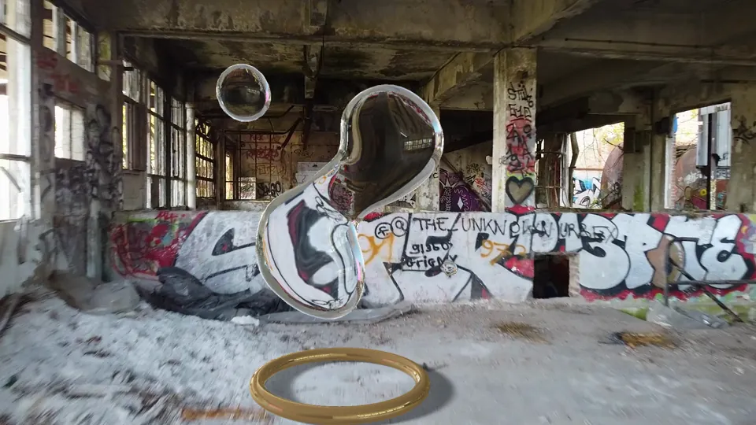
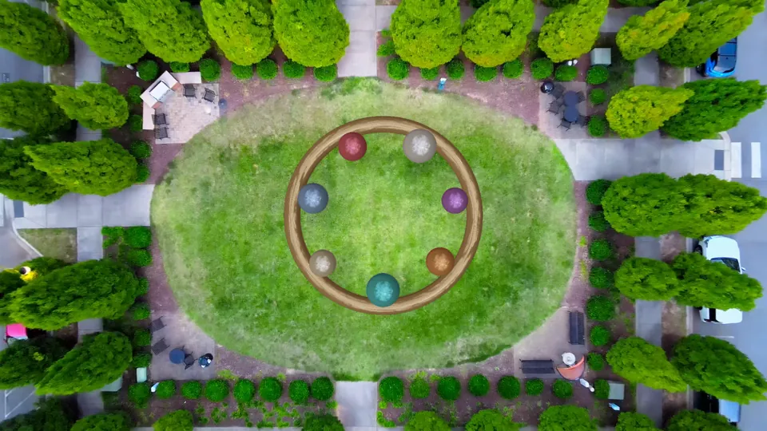
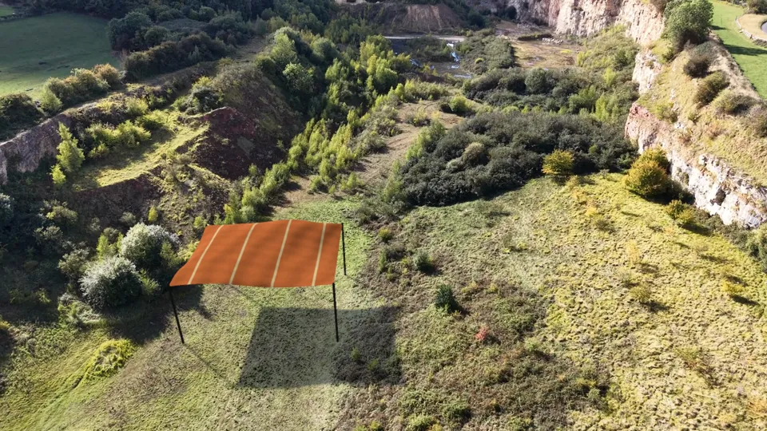
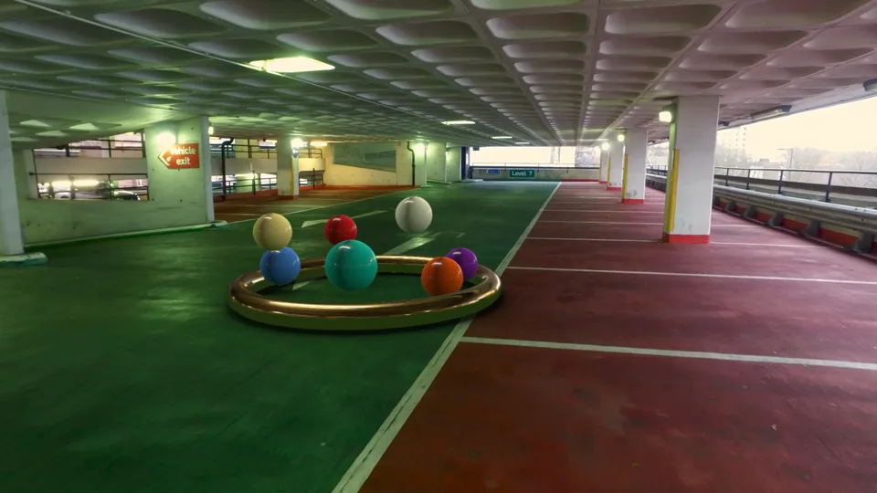

# COLMAP · OpenGL 실사 합성 패키지

C4D나 Blender 없이 **코드만으로** 실사 영상에 CG를 합성하는 수업용 패키지입니다.

1. 실사 영상의 카메라를 COLMAP과 PnP로 복원합니다.
2. 물·공·천 시뮬레이션은 CPU로 계산합니다.
3. 렌더는 네이티브 OpenGL로 하고, 원본 카메라에 맞춰 합성합니다.
4. 새 영상과 HDRI는 [재료 찾기 규칙](docs/materials.md)에 따라 라이선스를 확인하고 고릅니다.

Mac·Windows·Linux에서 Codex나 Claude Code와 함께 씁니다. 처음이라면 **[START-HERE](START-HERE.md)**부터 보세요.

| 실내 물 · `hall_water` | 정원 공 · `courtyard_spheres` |
| --- | --- |
|  |  |
| **채석장 천 · `quarry_cloth`** | **주차장 공 · `garage_spheres`** |
|  |  |

## 명령 한 줄씩

저장소 폴더에서 프로젝트 `.venv`의 Python으로 실행합니다. Windows에서는 `python` 대신 `.\.venv\Scripts\python.exe`를 씁니다.

```sh
python -m pipeline composite hall_water        # 소스 받기 → 카메라 → 지면 → 시뮬 → OpenGL 합성 → 검수
python -m pipeline status hall_water           # 어디까지 했는지, 다음 명령

python -m pipeline composite quarry_cloth
python -m pipeline relight quarry_cloth        # 해 방향·하늘광·그림자·블러·그레인

python -m pipeline composite garage_spheres
python -m pipeline light garage_spheres        # 플레이트에서 빛이 오는 방향 측정, HDRI 방향 맞추기
python -m pipeline relight garage_spheres      # 측정한 빛·HDRI 반사·그림자·질감·그레인
python -m pipeline qa-video garage_spheres --render work/garage_spheres/relight/final

python scripts/find_materials.py footage "drone abandoned hall"   # 쓸 수 있는 영상 찾기
python scripts/find_materials.py hdri "forest"                    # CC0 HDRI 찾기
```

영상·프레임·결과는 `work/<숏>/`에 저장되며 Git에는 올라가지 않습니다. 용량이 크면 `--work /외장SSD/폴더`를 붙이거나 환경변수 `VFX_WORK`를 지정하세요. 결과는 덮어쓰지 않으니, 다시 만들 때는 새 `--output` 폴더를 지정합니다.

## 파이프라인 밖의 예제

`python -m pipeline`의 숏 외에, 각자 README와 명령을 가진 예제가 `examples/`에 있습니다. 무엇이 더 필요한지는
`scripts/setup_environment.py --check`의 `examples` 항목이 알려 주고, 영상과 모델은 `scripts/fetch_assets.py`로 받습니다.

| 예제 | 내용 | 더 필요한 것 |
| --- | --- | --- |
| [Shader Live](examples/shader_live/README.md) | 카메라와 바닥 면을 풀고(COLMAP 또는 평면 호모그래피) GLSL 효과 하나를 장면에 고정. 작품 3편 | 영상 받기 |
| [무중력 과일](examples/fruit_physics/README.md) | MediaPipe로 사람의 3D 자세를 잡아 보이지 않는 강체로 만들고, MuJoCo 무중력 과일을 OpenGL로 렌더 | `--install --with body`, 영상·포즈 모델 받기 |
| [백보드 물](examples/backboard_water/README.md) | 네 모서리 PnP + OpenGL 물방울 | 없음 (`--demo`) |

```sh
python scripts/setup_environment.py --install --with body     # 과일 예제를 쓸 때만: MediaPipe, MuJoCo
python scripts/fetch_assets.py list                           # 받을 수 있는 영상과 모델, 받은 것
python scripts/fetch_assets.py footage 10708812               # Pexels 번호로 받기
```

몸 추적은 MediaPipe로 바로 시작합니다. 더 정밀한 SAM 3D Body는 Hugging Face에서 접근 신청과 승인이 먼저 필요합니다: [SAM 3D Body 안내](docs/sam-3d-body.md).

## 공정

| 단계 | 하는 일 | 결과 | 통과 기준 |
| --- | --- | --- | --- |
| `fetch` | `shots/*.json`에 적힌 원 배포처에서 영상과 HDRI를 받고 SHA-256을 대조 | `source/`, `lighting/` | 해시 일치 |
| `prepare` | 구간 자르기, 24fps CFR, 1280×720, PNG 프레임 추출, 3프레임마다 키프레임 | `frames/`, `keyframes/` | 프레임 수 = 길이×fps |
| `solve` | pycolmap SIFT(CPU) → 순차 매칭(초점 사전값 없이) → **고정 초점** 증분 복원 → 랜드마크 20% 유보 후 BA → `tracking/measure.py`의 양방향 LK + RANSAC PnP + LM으로 **모든 프레임** 포즈 계산 | `Camera_Three.json` | 키프레임 전부 등록, 보간 없음 |
| `qa-camera` | 유보 랜드마크로 재투영 오차 측정 | `qa/acceptance-camera.json` | p95 < 2px, 최대 < 8px, 이동 p95 < 1px |
| `ground` | 바닥 영역 점으로 RANSAC 평면 → Y-up, 기준 픽셀 광선으로 원점, 카메라 높이 1.6으로 스케일 | `Camera_Three_ground.json`, `layout.json` | `qa/ground-fit.jpg`의 초록 점이 바닥에 있는지 눈으로 확인 |
| `simulate` | 물(SPH 370입자 → MarchingCubes), 강체 구 7개, PBD 천 825정점 | `sim/` | 유한값, 겹침·변형률 한도 |
| `render` | ModernGL 네이티브 OpenGL. 굴절·HDRI 반사·그림자, 1.5배 SSAA | `Composite.mp4`, `Alpha.mov` | — |
| `qa-video` | 전체 디코드, 누락·중복·배경 훼손 검사, 검수 시트 | `video-qa.json`, `review_*.jpg` | 배경 MAE < 4 (**+ 사람이 전체 재생 확인**) |
| `light` | 플레이트의 밝은 곳(조명·창·트인 면)을 복원한 3D 위치로 옮겨 물체에서 본 빛 방향·세기·색을 측정하고, HDRI를 같은 방향으로 돌리고 밝기를 맞춤 | `light.json`, `qa/light-estimate.jpg`, `qa/light-probe.jpg` | 화살표가 실제 조명 쪽을 가리키는지 눈으로 확인 |
| `relight` | 천: 추정 태양광·하늘광·그림자 맵·블러·그레인. 공: 측정한 빛, 돌린 HDRI 반사, 실제 바닥색 반사광, 부드러운 그림자 + 접촉 그림자, 회전하는 표면 질감, 플레이트에서 잰 그레인 | `relight/final/` | `qa-video --render`로 검사 |

단계별 설명, 새 영상으로 바꾸는 법, 실패했을 때 고칠 곳은 **[워크플로](docs/workflow.md)**에 있습니다.

## PnP가 쓰이는 곳

PnP(Perspective-n-Point)는 3D 위치를 아는 점들이 화면의 2D 위치에 겹치도록 카메라의 회전과 이동을 구하는 방법입니다(OpenCV `solvePnP`).

| 어디 | 무엇으로 | 방법 |
| --- | --- | --- |
| `solve` 단계 (모든 숏) | COLMAP 키프레임 사이의 **모든 프레임** | COLMAP 3D 점을 양방향 LK로 따라간 2D 관측에 맞춤. RANSAC(EPnP) 뒤 LM 정밀화 — `tracking/measure.py` |
| `examples/backboard_water` | 농구대 유리 백보드의 네 모서리 | 가정한 판 크기(가로 1.8)의 모서리를 추적한 모서리에 맞춤 — 프레임마다 `solvePnP` |

PnP 오차가 작다는 것은 **맞춘 그 점들**에 잘 겹친다는 뜻일 뿐입니다. 그래서 `solve`는 계산에 쓰지 않은 랜드마크 20%로 따로 검수합니다(`qa-camera`).

## 꼭 알아야 할 가정

- **초점거리는 가정값입니다.** `fx=fy=850, cx=640, cy=360`(1280×720 기준)이고 렌즈 왜곡은 0으로 둡니다. 자유 초점 복원이 회전 위주의 드론 숏에서 발산해서 고정했습니다. 새 영상에서는 `camera.focal_px`를 바꿔 가며 검수 수치를 비교합니다.
- **스케일은 실측이 아닙니다.** 중간 프레임의 카메라 높이를 1.6으로 정규화했을 뿐입니다. 중력·바람·재질도 연출값입니다.
- **조명은 촬영 현장을 완전히 복원한 것이 아닙니다.** 반사는 별도의 CC0 HDRI입니다. 공 숏은 `light`가 플레이트에서 빛 방향·색·비율을 재지만, 카메라가 본 방향만 잴 수 있고 하얗게 날아간 조명의 실제 밝기는 가정값(`relight.clipped_gain`)입니다. 천 숏의 해 방향은 그림자를 보고 눈으로 추정했습니다.
- 좌표 변환은 이렇습니다. COLMAP 광학 좌표(+Y 아래, +Z 앞)에 `diag(1,-1,-1)`을 곱해 Three/OpenGL 좌표(Y 위, −Z 시선)로 바꾸고, `matrixWorld`는 column-major입니다. 투영 행렬은 K(fx, fy, cx, cy)로 직접 만들고, OpenCV 관측값에서는 0.5px를 뺍니다. 이 왕복은 `tests/`에서 검사합니다.
- 렌더 경로는 **ModernGL → 네이티브 OpenGL 3.3 이상**(Mac에서는 4.1 Metal)입니다. 브라우저 WebGL이 아닙니다. Three.js는 Node에서 물 표면 메시를 만드는 데만 씁니다.

## 폴더

| 폴더 | 내용 |
| --- | --- |
| `pipeline/` | 위 공정의 `python -m pipeline` 명령 |
| `shots/` | 숏 설정: 출처·라이선스·해시, 구간, 초점, 지면, 렌더 |
| `Water/` | SPH 물 솔버(Node)와 앞·뒷면 굴절 GLSL. Drift 예제와 공용 |
| `tracking/` | LK/PnP 프레임별 포즈(`measure.py`), COLMAP → Three 카메라(`export_colmap.py`) |
| `Source/` | Node 스크립트와 three.js 의존성(`npm ci --prefix Source`) |
| `docs/` | 설치, 워크플로, 재료 찾기, 검증 범위, 예제 설명 |
| `examples/` | 백보드 물, Shader Live, 무중력 과일. 위의 "파이프라인 밖의 예제" |
| `Camera/` `ae/` `scene/` | [Drift 예제](docs/drift.md)(보온병·찻잔 + 물, After Effects 빌드) |
| `scripts/` | 설치 점검(`setup_environment.py`), 예제 영상·모델 받기(`fetch_assets.py`), 긴 계산 분리 실행(`jobs.py`), 재료 찾기(`find_materials.py`) |
| `tools/` | 브레이크다운 영상 제작 도구(`tools/breakdown`, [설명](docs/breakdown/README.md)), 플레이트 조명 측정, OBS 녹화 안전 종료 |

모든 예제의 공통 순서는 [합성 프로세스 정리](docs/pipeline/README.md)에, 실제로 확인한 컴퓨터와 수치는 [검증 범위](docs/validation.md)에, 출처는 [THIRD_PARTY_NOTICES](THIRD_PARTY_NOTICES.md)에 있습니다.
