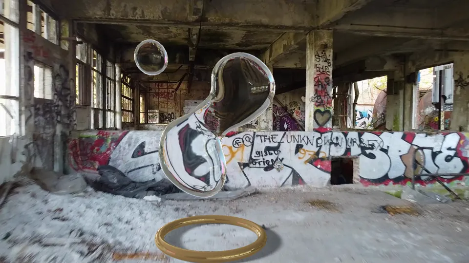
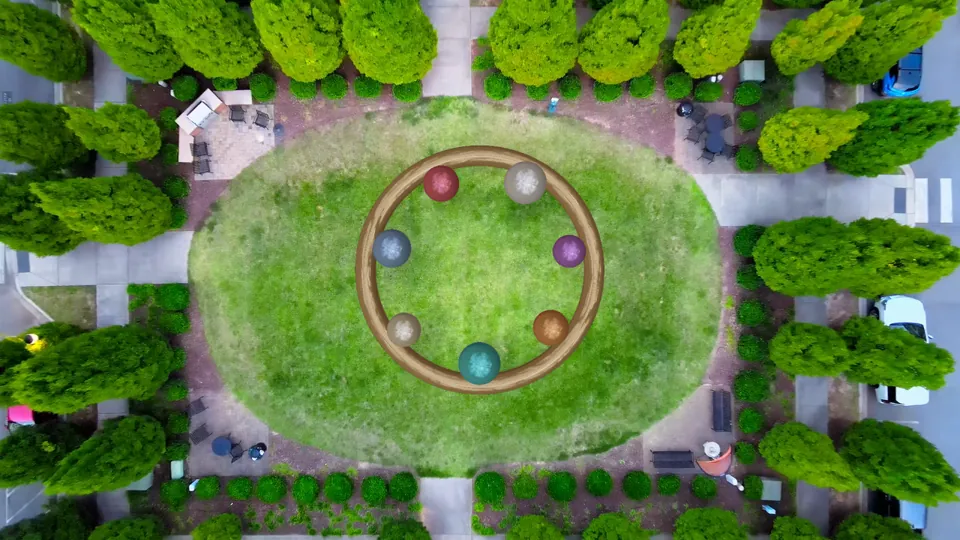
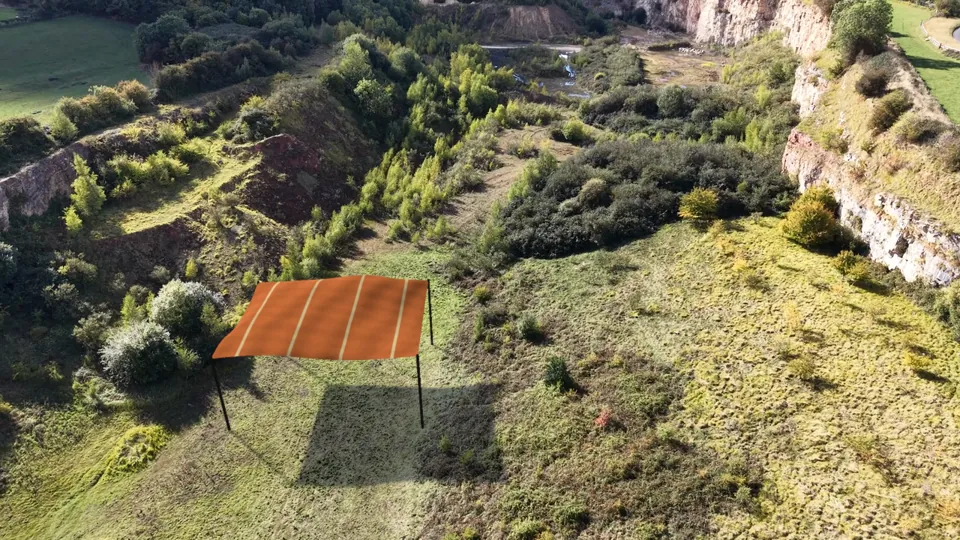

# 실사 합성 프로세스 정리 · COLMAP / PnP / OpenGL / After Effects

이 저장소의 예제는 모두 같은 순서를 따릅니다. 실사 플레이트에서 카메라를 복원하고(COLMAP 또는 PnP), 그 카메라의 월드에 CG를 맞춰 놓고(월드 정렬), 물리 시뮬레이션을 계산한 뒤, 네이티브 OpenGL로 렌더해 원본과 같은 프레임 단위로 합성합니다. 2026-11-09 기준입니다.

| 실내 물 · `hall_water` | 정원 공 · `courtyard_spheres` | 채석장 천 · `quarry_cloth` |
| --- | --- | --- |
|  |  |  |

## 예제 한눈에 보기

| 예제 | 카메라 | 월드 정렬 | 물리 | 렌더 · 합성 |
| --- | --- | --- | --- | --- |
| [실내 물 · 정원 공 · 채석장 천 · 주차장 공](../workflow.md) (`shots/`, `python -m pipeline`) | pycolmap 고정 초점 키프레임 + 20% 유보 검증 + 프레임별 LK/PnP | 바닥 RANSAC 평면, Y-up, 기준 픽셀 광선으로 원점, 카메라 높이 1.6 | SPH 370입자 / 강체 구 7개 / PBD 천 825정점 | ModernGL 네이티브 OpenGL. Python에서 합성 + AE용 Straight 알파. 천·주차장 공은 조명 통합(`relight`) |
| [Drift](../drift.md) (저장소 루트) | COLMAP, 리타임 숏은 OpenCV LK/PnP로 재보정 | COLMAP 희소 재구성 좌표계에 근·원경 궤적 배치 | Node.js SPH 입자 370개 | 물은 ModernGL 네이티브 OpenGL, 소품은 Three.js GLB. AE `ae/Build_Drift.jsx`로 AEP 생성 |
| [백보드 물](../../examples/backboard_water/README.md) | 유리 백보드 네 모서리 PnP | 백보드 평면 기준(가로 1.8 가정) | 물방울 부착·합류·흐름 모델 | ModernGL GLSL, Straight 알파를 AE에서 플레이트 위에 |
| [Shader Live](../../examples/shader_live/README.md) | pycolmap SfM 또는 평면 호모그래피 솔버 | RANSAC 평면, 기준 화소로 원점과 +x, 카메라 높이로 축척 | 없음 | 화면 전체 GLSL 프래그먼트 셰이더 하나(ModernGL). 플레이트 반사·재투영·색 키. AE용 Straight 알파 |
| [무중력 과일](../../examples/fruit_physics/README.md) | 고정 카메라 가정, 몸은 MediaPipe 33관절 + PnP | 사람 기준 좌표, 초점거리 스윕 | MuJoCo 무중력 강체, 몸은 보이지 않는 캡슐 | ModernGL 과일 렌더, 인물 마스크로 가림 |
| [주방 글리치](../../examples/kitchen_glitch/README.md) | 없음 (2D) | 없음 | 없음 | FFmpeg 필터그래프만 사용 |

렌더 경로는 이름을 정확히 적습니다. 최종 픽셀은 ModernGL로 그리는 **네이티브 OpenGL 3.3 이상**(Mac은 4.1 Metal)이고, 브라우저 WebGL이 아닙니다. Three.js는 Node에서 물 표면 메시와 Drift 소품(GLB)을 만드는 데만 씁니다.

## 1. 소스 확보

- 영상과 HDRI는 [재료 찾기](../materials.md) 규칙대로 고릅니다. 카메라가 이동하고, 컷이 없고, 줌이 고정이고, 라이선스를 배포처 페이지에서 확인한 것만 씁니다.
- 출처, 제작자, 라이선스, 다운로드 주소, SHA-256은 `shots/<숏>.json`에 남깁니다. 다른 컴퓨터는 `fetch`로 같은 파일을 받아 해시를 대조합니다.
- 받은 뒤 `ffprobe`로 실제 해상도·fps·길이를 확인합니다. 배포처의 파일 이름과 실제 해상도가 다를 때가 있습니다.
- 영상과 렌더 결과는 저장소에 넣지 않습니다. 스크립트, 설정, 카메라 JSON 같은 작은 해석 결과, 미리보기 이미지만 넣습니다.

## 2. 플레이트 준비

`python -m pipeline prepare <숏>`이 구간을 자르고, 일정한 fps(CFR)와 작업 크기(1280×720)로 바꾸고, `frames/frame_000000.png`부터 번호를 매깁니다. 키프레임은 3프레임 간격에 마지막 프레임을 더해 복사합니다. 모든 단계는 0번 프레임을 플레이트 0번으로 셉니다.

## 3. 카메라 복원

**카메라가 움직이는 숏 → COLMAP + 프레임별 PnP**

1. 키프레임에서 SIFT 특징을 뽑고 순차 매칭합니다. 이때 **초점 사전값을 넣지 않습니다**(미보정 F/H 검증). 잘못된 초점으로 보정 검증을 하면 매칭 분류가 틀어집니다.
2. 매칭이 끝난 뒤 카메라를 고정 초점 핀홀로 두고 증분 복원합니다. 초점을 자유롭게 풀면 회전이 많은 드론 숏에서 잘못된 값으로 수렴할 수 있습니다. 모르면 850px(1280 폭 기준)에서 시작하고, 750 / 850 / 1000을 각각 새 작업 폴더에서 풀어 검수 수치로 비교합니다.
3. 3D 점의 20%를 지우고 번들 조정을 다시 합니다. 지운 점은 카메라 계산에 쓰지 않고 검수에만 씁니다.
4. 키프레임 사이의 **모든 프레임**은 양쪽 키프레임에서 양방향 LK로 점을 따라간 뒤 RANSAC PnP(EPnP) + LM으로 포즈를 구합니다(`tracking/measure.py`). 보간으로 메운 프레임은 없습니다.
5. 리타임(슬로모션) 숏은 원래 숏의 카메라를 보간하지 말고, 리타임 영상의 특징점에 다시 맞춥니다. Drift에서 근경 이동 오차 95백분위가 8.72px에서 2.39px로 줄었습니다([트래킹](../../tracking/README.md)).

**크기를 아는 평면이 보이는 숏 → PnP**

백보드 예제처럼 크기를 아는(또는 가정한) 평면의 네 모서리를 추적했다면 프레임마다 `solvePnP`로 카메라를 풉니다. 같은 네 점에 대한 피팅 오차는 거의 0이 되지만, 그것은 독립 검증이 아닙니다. 판 크기나 초점이 틀리면 화면에서는 맞아 보여도 깊이와 반사각이 틀립니다. 실제 사용 전에는 다른 점과 처음·중간·끝·최악 프레임의 미끄러짐을 따로 확인합니다.

## 4. 월드 정렬과 CG 배치

- 중간 프레임의 바닥 영역 3D 점으로 RANSAC 평면을 찾고, 법선을 Y축으로 둡니다. 기준 픽셀(`ground.anchor`)에서 쏜 광선이 평면에 닿는 곳이 원점입니다.
- 스케일은 실측이 아닙니다. 중간 카메라 높이가 1.6이 되도록 맞춘 가정값입니다. 물체 크기는 화면 폭 대비 비율(`width_fraction`)로 정합니다.
- CG는 모두 월드 좌표로 정의하고, 프레임마다 복원한 카메라로 그립니다. 화면 좌표로 그리면 카메라가 움직일 때 미끄러집니다.
- 좌표 변환: COLMAP 광학 좌표(+Y 아래, +Z 앞)에 `diag(1,-1,-1)`을 곱해 OpenGL 좌표(Y 위, −Z 시선)로 바꿉니다. 투영 행렬은 K(fx, fy, cx, cy)에서 직접 만들어 추적 카메라와 렌더 카메라를 일치시킵니다. 이 왕복은 `tests/`에서 검사합니다.
- **반드시 `qa/ground-fit.jpg`를 봅니다.** 초록 점이 실제 바닥에 있고 빨간 십자가 물체를 세울 자리에 있어야 합니다.

## 5. 물리

| 시뮬레이션 | 쓰는 곳 | 내용 |
| --- | --- | --- |
| SPH 물 | 실내 물, Drift | Node.js에서 입자 370개의 압력·응집·점성을 계산하고, three.js MarchingCubes로 프레임마다 표면을 만듭니다. 같은 종류의 CPU에서는 항상 같은 결과가 나오지만, Apple Silicon과 일반 PC(x64)는 결과가 조금 다릅니다. |
| 강체 구 | 정원 공 | 구 7개, 낮은 중력, 바닥·원형 벽과의 충돌과 반발 |
| PBD 천 | 채석장 천 | 33×25 격자, 네 모서리를 기둥에 고정, 중력과 바람 |
| 물방울 | 백보드 물 | 유리면 부착·합류·흘러내림을 단순화한 모델(완전한 유체 해석 아님) |

중력·바람·재질 값은 연출값입니다. 실측이라고 쓰지 않습니다.

## 6. 렌더

- 프레임마다 카메라로 view·projection을 만들고, 플레이트를 텍스처로 올린 뒤 깊이 테스트로 CG를 그립니다.
- 물은 앞·뒷면 굴절과 HDRI 반사를 씁니다. HDRI는 현장 조명을 측정한 것이 아니라 비슷한 빛을 고른 CC0 자료입니다.
- 1.5배 SSAA를 premultiplied 상태로 축소합니다. 가장자리에 검거나 밝은 테두리가 생기지 않습니다.
- 천 숏은 `relight`로 추정한 해 방향의 직사광, 하늘광, 실제 형상의 그림자 맵, 0.45px 블러, 그레인을 더합니다.
- 공 숏은 `light`가 플레이트에서 빛 방향·색·비율과 바닥색·그레인을 재고 HDRI를 그 방향으로 돌립니다. `relight`는 그 빛으로 확산광·하이라이트·HDRI 반사·바닥 반사광, 부드러운 그림자와 접촉 그림자, 회전하는 표면 질감, 그레인을 넣습니다([워크플로 7절](../workflow.md#7-light--relight--조명-통합)).

## 7. 가림

| 예제 | 방법 |
| --- | --- |
| 실내 물 · 정원 공 · 채석장 천 | 가림 마스크를 만들지 않습니다. 기둥이나 나무가 앞을 지나가지 않는 자리에 물체를 둡니다. |
| Drift | AE Advanced 3D에서 소품과 카메라를 함께 렌더합니다. |
| 백보드 물 | 앞을 가리는 물체가 있으면 회색조 매트를 `--holdouts`로 넣습니다. |

## 8. 출력 규약

원본과 **같은 크기·fps·프레임 수, 같은 0번 프레임**으로 냅니다.

| 예제 | 합성본 | AE용 알파 |
| --- | --- | --- |
| 실내 물 · 정원 공 · 채석장 천 · 주차장 공 | `render/final/Composite.mp4` (천·주차장 공은 `relight/final/Composite.mp4`) | `Alpha.mov` (ProRes 4444 Straight. 주차장 공은 그림자도 검은색 + 알파로 포함) |
| Drift | AEP의 01 DRIFT | 03 ALPHA를 RGB + Alpha로 렌더, 물 패스 `Water/Water_Refraction.mov` |
| 백보드 물 | `Composite.mp4` | `Alpha.mov` |

물의 알파에는 그 플레이트를 굴절시킨 색이 들어 있어서 다른 배경에 그대로 옮기면 맞지 않습니다.

## 9. After Effects 합성

**자동 빌드 (Drift):** 빈 프로젝트에서 **File → Scripts → Run Script File**로 `ae/Build_Drift.jsx`를 실행하면 `Drift_08s.aep`가 생깁니다. 모델·카메라·환경광까지 만들어 줍니다. [AE 사용법](../../ae/README.md)

**알파 패스 올리기 (세 숏, 백보드 물):**

1. 알파 MOV를 가져와 **Interpret Footage → Alpha: Straight - Unmatted**로 둡니다. 프레임레이트가 플레이트와 같은지 확인합니다.
2. 같은 구간의 원본 플레이트를 아래에 놓고 0번 프레임을 맞춥니다. 알파는 원본 좌표와 같아서 위치·스케일 조정이 필요 없습니다.
3. 블렌딩, 그레인, 색 보정, 라이트랩은 이 단계에서 AE로 얹습니다.

검증된 AE 경로는 Drift(After Effects 26.5)입니다. 세 숏과 백보드 물의 알파는 AE에서 열어 검증하지 않았습니다.

## 10. 검수

- **카메라:** `qa-camera`가 지운 랜드마크로 재투영 오차를 잽니다. p95 < 2px, 최대 < 8px, 프레임 간 이동 p95 < 1px, 검증 트랙 40개 이상이어야 다음 단계로 갑니다.
- **영상:** `qa-video`가 모든 프레임을 디코드해 누락·중복·배경 훼손(알파 바깥 MAE < 4/255)을 검사하고 검수 시트를 만듭니다.
- **눈으로 보기:** 검수 시트를 보고 `Composite.mp4`를 처음부터 끝까지 재생합니다. 카메라 점프, 바닥 미끄러짐, 떨림, 잘못된 가림, 검은 프레임이 없는지 봅니다.
- 자동 검사, 스틸 검수, 실제 재생 확인은 구분해서 적습니다. 재생해 보지 않았으면 그렇게 씁니다.

## 11. 겪은 문제와 해결

| 증상 | 원인 | 해결 |
| --- | --- | --- |
| 채석장 카메라 p95 3.49px로 검수 실패 | 특징 추출부터 초점 850을 넣어 보정 검증(E 행렬)으로 매칭 | 초점 없이 매칭하고 매핑 직전에만 고정 초점 |
| 초점을 자유롭게 두면 복원이 발산 | 회전 위주 드론 숏의 초점 모호성 | 고정 초점, 여러 값을 따로 풀어 검수 수치로 비교 |
| `Only n/33 keyframes registered` | 하드컷, 흐림, 움직이는 물체가 많은 구간 | 구간을 줄이거나 다른 영상 |
| 슬로모션 숏에서 근경이 미끄러짐 | 원래 숏 카메라를 시간 보간 | 리타임 영상 특징점에 다시 맞춤(Drift 8.72px → 2.39px) |
| CI에서 Windows·Linux만 물 굽기 해시 불일치 | CPU 종류(x64/arm64)별 부동소수점 차이 | CPU 종류별로 기록한 해시와 비교 |
| 같은 입력인데 카메라 수치가 실행마다 조금 다름 | pycolmap 멀티스레드 | 정확한 값이 아니라 통과 기준으로 비교 |
| 칠한 바닥에서 바닥 맞추기가 멈춤 | 기본 영역에 특징점이 14개뿐 | `qa/ground-candidates.jpg`를 보고 `roi` 지정 |
| 빛 방향이 엉뚱함(먼 곳을 가리킴) | 천장 조명과 트인 면을 한 방향으로 평균, 카메라 자리에서 측정 | 밝은 곳을 3D에 놓고 물체 자리에서 측정, 두 무리로 나눔 |
| 공 가운데에 가로 경계선 | 위(HDRI)와 아래(바닥색) 빛을 급하게 바꿈 | 코사인 가중으로 섞고, 반사 경계는 거칠기만큼 흐림 |
