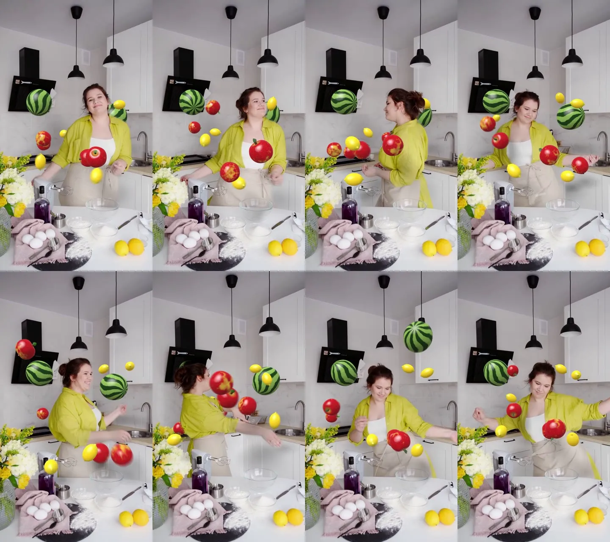

# 무중력 과일 · MediaPipe 포즈 + MuJoCo + 네이티브 OpenGL

춤추는 사람 주변에 사과, 레몬, 수박이 무중력으로 떠 있고, 몸에 맞으면 실제 물리로 튕겨 나가는 합성입니다. 사람의 3D 포즈로 보이지 않는 강체를 만들고, 과일은 OpenGL로 렌더한 뒤 사람과 깊이를 비교해 가립니다.



전체 공정에서의 위치는 [합성 프로세스 정리](../../docs/pipeline/README.md)에 있습니다.

## 소스

- Pexels 7525471 "Woman Dancing in the Kitchen", 촬영 SHVETS production, Pexels License. [source/SOURCE.md](source/SOURCE.md)
- 실제 파일은 720×1280, 25fps, 391프레임입니다. 결과는 1080×1920 업스케일입니다.

## 사용한 오픈소스 (2026-11-09 설치 버전)

| 도구 | 역할 |
| --- | --- |
| MediaPipe 1.2.2 Pose Landmarker **heavy** (Apache 2.0) | 33관절 2D, 미터 단위 3D(world landmarks), 인물 분할 마스크 |
| MuJoCo 4.0.0 (Apache 2.0) | 물리 엔진 |
| moderngl 5.13.0 | 네이티브 OpenGL 3.3 컨텍스트 (RTX 4070 Ti SUPER) |
| OpenCV, NumPy, SciPy, FFmpeg | PnP, 필터, 인코딩 |

## 실행

Python 3.12에서 이 폴더 기준으로 실행합니다.

저장소 루트의 `.venv`를 써도 됩니다. 루트에서 `python scripts/setup_environment.py --install --with body`,
`python scripts/fetch_assets.py pose-model`, `python scripts/fetch_assets.py footage 7525471`을 실행하면 아래의 venv 만들기,
모델 받기, 영상 받기를 대신합니다. 그때는 아래 명령의 `./venv/Scripts/python`을 루트 `.venv`의 python으로 바꿉니다.
몸 추적은 MediaPipe가 기본입니다. SAM 3D Body는 접근 신청과 승인이 필요한 선택 사항입니다: [안내](../../docs/sam-3d-body.md).

```sh
python -m venv venv && ./venv/Scripts/python -m pip install -r requirements.txt   # macOS/Linux: venv/bin/python
mkdir -p models work/frames
curl -L -o models/pose_landmarker_heavy.task \
  https://storage.googleapis.com/mediapipe-models/pose_landmarker/pose_landmarker_heavy/float16/latest/pose_landmarker_heavy.task
ffmpeg -v error -y -i source/Pexels_7525471_720x1280.mp4 -start_number 0 work/frames/%04d.png   # 0부터 번호

./venv/Scripts/python track_pose.py          # → work/pose.json, work/mask/
./venv/Scripts/python solve_body.py sweep    # 초점거리별 재투영 오차 확인
./venv/Scripts/python solve_body.py 850      # → work/body_cam.json
./venv/Scripts/python sim.py                 # → work/sim.json. FRUIT_SEED로 배치 변경, --search로 시드 탐색
./venv/Scripts/python render.py Fruit_ZeroG_Physics.mp4   # --frames a,b 스틸, --layers 디버그 패스
```

`viz_pose.py`, `viz_body.py`, `viz_sim.py`는 각 단계 결과를 영상 위에 그려 보는 디버그 스크립트입니다. 전체 렌더는 RTX 4070 Ti SUPER에서 3분 40초 걸렸습니다.

## 파이프라인

1. **`track_pose.py`:** 391/391프레임에서 사람을 찾았습니다. VIDEO 모드라 프레임 간 추적이 이어집니다.
2. **`solve_body.py`:** 3D 관절과 2D 관절을 `cv2.solvePnP`로 맞춰 카메라 공간 깊이를 구합니다(첫 프레임 SQPNP, 이후 이전 해에서 반복).
   - PnP만 쓰면 관절이 화면에서 약 18px 어긋납니다. 깊이는 PnP 값을 쓰고, 각 관절은 2D 위치의 광선 위에 다시 놓아 화면과 정확히 맞춥니다.
   - 시간 축으로 Savitzky-Golay(창 9, 2차) 스무딩을 합니다. 포즈 떨림이 그대로 과일을 차기 때문입니다.
   - 초점거리는 재투영 오차로 구분되지 않았습니다(f 550~1600에서 20.2→16.7px). 폰 메인 카메라에 가까운 f=850px(가로 46°)로 정했고, 이때 사람까지 1.25~1.77m입니다.
3. **`sim.py`:** MuJoCo 무중력 시뮬레이션, 1프레임당 40서브스텝입니다.
   - **보이지 않는 몸:** 머리, 목, 가슴, 배, 어깨, 골반, 위팔·아래팔, 손, 허벅지를 캡슐과 구 14개(각 40kg)로 만듭니다. 매 서브스텝 추적 포즈로 가는 선속도와 각속도를 직접 넣는 키네마틱 강체라, 팔 휘두르는 속도가 과일에 그대로 전달됩니다.
   - **충돌 비트:** 몸 contype 2 / conaffinity 0, 과일 1/3, 방 0/1. 몸끼리는 충돌하지 않고, 과일은 몸·과일·방과 부딪힙니다.
   - **과일:** 사과 5(반지름 5.8cm), 레몬 5(4.8cm 타원체), 수박 2(13.5cm 타원체). 중력 0, 공기 저항, 탄성 접촉, 마찰로 회전합니다.
   - **보이지 않는 방:** 식탁 면(15.6° 기울기 평면), 뒷벽(z=2.3m), 화면 경계의 부드러운 벽이 있습니다. 맞은 과일은 주기 4.5초의 아주 약한 복원력으로 제자리 근처를 떠돕니다. 연출상 넣은 값입니다.
   - **배치:** 80%는 실제 손목·팔꿈치 궤적 근처, 20%는 주변에 둡니다. 시드 40개 중 손이 닿는 과일 수와 시간 분산이 가장 좋은 시드 6을 골랐습니다. 결과는 8개가 12~265프레임에 걸쳐 맞고 최대 1.47m/s로 튕깁니다.
   - 셔터 180° 모션블러용으로 프레임마다 0, 0.125, 0.25, 0.375, 0.5 시점의 자세를 저장합니다.
4. **`render.py`:** OpenGL 렌더와 합성입니다.
   - 투영 행렬은 OpenCV K에서 만듭니다. 그래서 추적 카메라와 OpenGL 카메라가 같습니다.
   - 과일은 절차적 메시(사과 꼭지 홈·줄기·잎, 레몬 양끝, 수박)와 GLSL 절차적 질감·범프를 씁니다. 반구광, 키라이트, 하이라이트, 창 반사가 들어갑니다.
   - **깊이 가림:** 몸 캡슐을 깊이로 래스터라이즈하고, 그 깊이를 MediaPipe 마스크(가이디드 필터로 경계 정리) 영역에 최근접 값으로 채웁니다(`distanceTransformWithLabels`). 과일 픽셀이 그보다 뒤면 가립니다. 과일끼리의 앞뒤는 깊이 버퍼로 처리합니다.
   - **그림자:** 키라이트 방향의 해석적 구 그림자와 AO를 사람 표면, 식탁 면, 뒷벽에 넣습니다.
   - 4x MSAA float FBO, 서브프레임 5장 모션블러입니다.

## After Effects

이 예제는 Python에서 바로 최종 합성까지 합니다. AE용 Straight 알파 패스와 깊이 패스는 아직 내보내지 않습니다. AE에서 다시 합성하려면 `render.py`에 과일 RGBA와 가림 마스크를 따로 쓰는 출력을 추가해야 합니다.

## 한계

- 깊이는 사람 포즈에서만 나옵니다. 배경 깊이 모델이 없어서 식탁 위 꽃이나 믹서 뒤로 과일이 지나가도 가려지지 않습니다.
- 몸은 캡슐 근사입니다. 헐렁한 셔츠 자락이나 머리카락은 마스크로만 가리고, 충돌은 캡슐 기준입니다.
- 초점거리와 식탁 평면은 화면을 보고 추정한 값입니다.
- 원본이 720p라 1080p 결과는 업스케일입니다.
