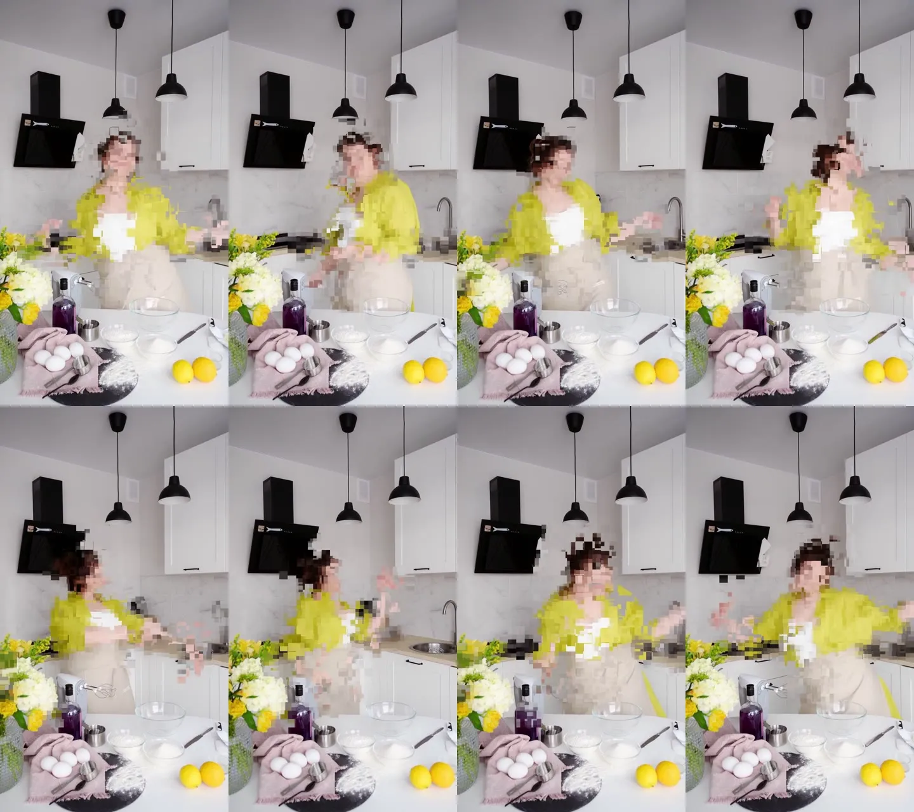

# 주방 데이터모시 · ffmpeg 매크로블록 글리치

움직이는 사람만 매크로블록 데이터모시로 깨지고 배경은 원본 그대로 남는 예제입니다. 픽셀 처리는 모두 ffmpeg 필터그래프이고, 분할 모델 없이 움직임만으로 사람을 잡습니다. 블록마다 이전 프레임을 붙잡아 두는 블록 홀드 방식이고, 마스크는 움직임에서 만듭니다.



## 소스

- Pexels 7525471 "Woman Dancing in the Kitchen", 촬영 SHVETS production, Pexels License. [source/SOURCE.md](source/SOURCE.md)
- 페이지에는 1080×1920으로 적혀 있지만 실제 파일은 **720×1280, 25fps, 391프레임**입니다. 결과는 1080×1920으로 업스케일합니다.
- 영상은 저장소에 넣지 않았습니다. 저장소 루트에서 `python scripts/fetch_assets.py footage 7525471`로 받을 수 있습니다. 받아서 `source/Pexels_7525471_720x1280.mp4`로 두세요. [과일 물리 예제](../fruit_physics/README.md)도 같은 파일을 씁니다.

## 실행

이 폴더에서 실행합니다.

```sh
bash run_glitch.sh 12      # LMAX: 블록이 멈춰 있는 최대 프레임 수
```

- `Kitchen_Datamosh_Glitch.mp4`(1080×1920, 25fps, 391프레임)와 실제로 깨지는 블록을 보여 주는 `work/motion_mask.mp4`가 나옵니다.
- `make_graph.py` 상단 값으로 조절합니다: `BLOCK`(40), `MOSAIC`(20), `SPEED`(끌림 6), `DMAX`(최대 끌림 110px), `TH`(움직임 감도 12), 그리고 깨지는 비율 `inten`.

## 방식

1. **사람 마스크:** 3프레임 전과의 차이(`blend=difference`)를 40px 블록 평균으로 냅니다. `lagfun`으로 방금 지나간 자리를 잠시 남기고, 임계값을 건 뒤 `dilation`으로 한 칸 키웁니다.
2. **블록 홀드:** 블록마다 갱신 주기(2~12프레임)와 위상이 다릅니다. 27×48 격자에서 `geq` 해시로 제어 맵을 만들고 `flags=neighbor`로 키웁니다. `tpad` 지연 스트림 12개를 `maskedmerge`로 골라 이전 프레임 블록이 남습니다.
3. **블록 끌림:** 멈춘 블록을 `displace`로 아래와 옆으로 계속 밉니다. 끌림은 홀드가 길수록 커집니다.
4. 블록 안은 `pixelize` 20px 평균으로 뭉갭니다. 깨지는 비율은 60%를 기본으로 하고 순간적으로 98%까지 버스트합니다.

## After Effects

이 예제는 ffmpeg 출력이 최종입니다. AE 프로젝트는 만들지 않았습니다. 원본 위에 다시 손대려면 결과와 원본을 같은 25fps 타임라인에 겹치면 프레임이 1:1로 맞습니다.

## 한계

- 손떨림이 약간 있어서 식탁 위 물건의 블록 한두 개가 가끔 잘못 깨집니다.
- 사람이 멈추면 그 부분은 덜 깨집니다. 움직임으로만 마스크를 잡기 때문입니다.
